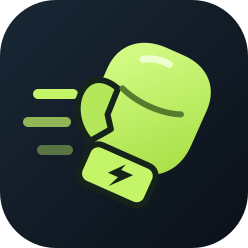

# Jab Pulse

**構えて、合図を感じて、打つ。**

Amazfit Bip 6向けのZepp OSアプリです。ジャブ時の手首スピードを推定し、時計内に練習履歴を残します。構えたまま画面を見ずに使えるよう、準備完了と記録成功を振動で知らせます。

リポジトリ名の *Pulse* は、一発の動きと手首に届く合図から。時計上のアプリ名は **Jab Speed** です。

<p align="center"></p>

## できること

- 各打の推定ピーク速度と動作区間の長さ、練習ごとの平均・最高値・発数の表示
- 直近30回、1回200発までの時計内保存。検出ごとに保存
- 各打と過去の練習の閲覧、m/s・km/h切り替え、3段階の検出感度
- 準備・記録成功・終了・エラーの振動通知
- 保存失敗時の再試行、200発または30分で自動終了

**速度は未検証の推定値です。拳の実速度や打撃力を保証するものではありません。** ジャブ以外の動きを分類する機能はありません。実機での検出率・速度精度の評価は今後の課題です。

## 使い方

1. ジャブを打つ側の手首に時計を着け、ベルトを緩みなく締めます。
2. 「計測を開始」を押し、構えたまま約1秒静止します。
3. 短い振動1回が終わったら、ジャブを一発打ちます。
4. 短い振動2回で検出・保存成功。構えに戻し、次の準備完了の合図を待ちます。
5. 「終了して保存」で終了し、「履歴」で結果を確認します。

| 振動 | 意味 |
| --- | --- |
| 短く1回 | 準備OK |
| 短く2回 | 検出・保存成功 |
| 長めに1回 | 計測終了 |
| 短く3回 | 保存失敗やセンサーエラー。画面を確認 |

一発ずつの練習を想定しています。比較するときは、装着位置・手・構え・感度をそろえてください。反応が悪ければ感度を高く、誤検出が多ければ低くしてください。通知は振動のみです。

## 開発

対象は **Amazfit Bip 6 / 390 × 450 / Zepp OS API Level 3.0以降**。Node.js 22で開発しています。

```sh
npm ci
npm test
npm run build
```

ビルド成果物は `dist/` に出力します。アイコンは `assets/icon.svg` を編集し、`npm run icon:build` でPNGに反映します。

### 実機プレビュー

Zeppアプリと時計をペアリングし、Zeppアプリ側の開発者モードを有効にして実行します。

```sh
npx zeus login
npm run preview
```

生成されたQRをZeppで読み取ります。QR画像は `dist/preview-qr.png` にも保存されます。プレビューはBip 6と旧形式のZPKファイル名を明示します。Zeus CLI 1.9.2内部のQR生成機能を使っているため、CLIの更新時にはスクリプトの互換性を確認してください。

`app.json` のIDはローカル開発用です。ストア配布にはDeveloper Consoleで取得したIDと審査などの手続きが必要です。実機で更新できたアプリID・英語の登録情報・日本語UIの構成を維持しています。

### 検証

`npm test` は依存パッケージなしで動作する12件のテストです。疑似加速度による検出・積分・姿勢変更・異常入力、履歴保存と再試行、画面操作、振動回数と停止、モーター入力の除外を確認します。GitHub Actionsでも実行します。

実機では準備と成功の振動、ジャブの検出率、戻り動作の二重検出、再起動後の履歴を確認してください。速度精度の評価には高速度撮影などの外部基準が必要です。

## 構成

| ファイル | 役割 |
| --- | --- |
| `page/gt/home/index.page.js` | 計測・履歴・設定UIとセンサー制御 |
| `lib/jab-detector.js` | 静止補正、動作検出、速度推定 |
| `lib/haptic-feedback.js` | 振動パターンとタイマー管理 |
| `lib/history.js` | 履歴保存と統計 |
| `assets/icon.svg` | 専用アイコンの編集元 |
| `scripts/preview.cjs` | 実機プレビューとQR画像の生成 |
| `tests/jab.test.mjs` | 検出・保存・UI・振動の自動テスト |

検出の仕組みと限界、保存データの説明は [docs/detection.md](docs/detection.md) にまとめています。認証情報、プレビューURLとQR、ビルド成果物、個人の練習データ、インストール切り分け用ファイルはコミット対象から除外します。

API仕様: [Accelerometer](https://docs.zepp.com/docs/reference/device-app-api/newAPI/sensor/Accelerometer/) / [Vibrator](https://docs.zepp.com/docs/v2/reference/device-app-api/newAPI/sensor/Vibrator/) / [LocalStorage](https://docs.zepp.com/docs/reference/device-app-api/newAPI/storage/localStorage/)
